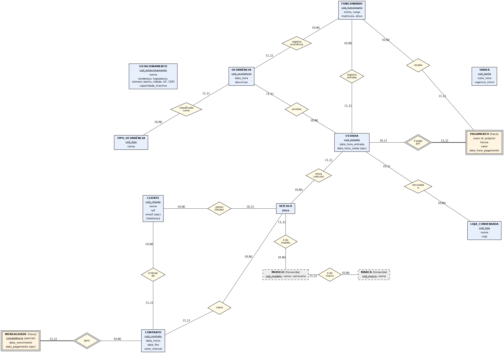

# Modelo conceitual

Diagrama: [`der_conceitual.png`](der_conceitual.png) (vetorial: [`der_conceitual.svg`](der_conceitual.svg)).
Arquivo do projeto (fonte editável, Graphviz): [`der_conceitual.dot`](der_conceitual.dot).
Ferramenta: Graphviz (`neato`), em vez do brModelo — permitido pelo enunciado desde que haja DER com cardinalidades (mín, máx) e legenda.

## Legenda

| Símbolo | Significado |
|---|---|
| Retângulo | Entidade |
| Retângulo de borda dupla | Entidade **fraca** (não existe sem a entidade dona) |
| Retângulo tracejado cinza | Entidade fornecida pelo professor (`modelo`, `marca`) |
| Losango | Relacionamento |
| Losango de borda dupla (e traço grosso até a fraca) | Relacionamento **identificador** da entidade fraca |
| <u>sublinhado</u> | Atributo identificador |
| `{telefone}` | Atributo **multivalorado** |
| `(endereço: ...)` | Atributo **composto** |
| `(opc)` | Atributo opcional (pode ficar vazio) |
| `(mín,máx)` na linha | Cardinalidade da entidade **naquele relacionamento**: mínimo 0 = participação opcional, 1 = obrigatória; máximo 1 = no máximo uma ocorrência, N = várias. Ex.: `Cliente (0,N) — possui — (0,1) Veículo` lê-se "um cliente possui de zero a N veículos; um veículo pertence a zero ou um cliente". |

## Entidades e atributos

| Entidade | Atributos | Observação |
|---|---|---|
| ESTACIONAMENTO | **cod_estacionamento**, nome, endereço (composto: logradouro, número, bairro, cidade, UF, CEP), capacidade_maxima | RN03. Entidade única, sem relacionamentos (unidade única). |
| CLIENTE | **cod_cliente**, nome, cpf, email (opc), {telefone} | Telefone multivalorado. |
| VEÍCULO | **placa** | Só carros (RN01). |
| MODELO, MARCA | (fornecidas) | Não podem ser alteradas. |
| CONTRATO | **cod_contrato**, data_inicio, data_fim, valor_mensal | RN12. |
| MENSALIDADE (fraca) | competência (identificador parcial), data_vencimento, data_pagamento (opc) | RN13. Identificada por Contrato + competência. |
| ESTADIA | **cod_estadia**, data_hora_entrada, data_hora_saida (opc) | RN06. Tipo (rotativa/mensalista) é derivado, não é atributo. |
| PAGAMENTO (fraca) | forma, valor, data_hora_pagamento | RN10. Identificado pela Estadia (relação 1:1). |
| TARIFA | **cod_tarifa**, valor_hora, vigencia_inicio | RN08/RN09. Ligada à estadia por **data** (consulta), não por relacionamento. |
| LOJA_CONVENIADA | **cod_loja**, nome, cnpj | RN11. |
| FUNCIONÁRIO | **cod_funcionario**, nome, cargo, matricula, ativo | Cadastro simples. |
| OCORRÊNCIA | **cod_ocorrencia**, data_hora, descricao | RN15. |
| TIPO_OCORRÊNCIA | **cod_tipo**, nome | Domínio dos tipos. |

## Relacionamentos

| Relacionamento | Entidades e cardinalidades | Regra |
|---|---|---|
| possui (titular) | Cliente (0,N) — Veículo (0,1) | RN02 |
| é do modelo | Veículo (1,1) — Modelo (0,N) | RN01 |
| é da marca | Modelo (1,1) — Marca (0,N) | base fornecida |
| é titular de | Cliente (0,N) — Contrato (1,1) | RN12 |
| cobre | Contrato (1,1) — Veículo (0,N) | RN12 (um único veículo por contrato) |
| gera (identificador) | Contrato (0,N) — Mensalidade (1,1) | RN13 |
| entra | Veículo (0,N) — Estadia (1,1) | RN06 |
| registra entrada | Funcionário (0,N) — Estadia (1,1) | RN06 |
| é paga por (identificador) | Estadia (0,1) — Pagamento (1,1) | RN07/RN10 |
| recebe | Funcionário (0,N) — Pagamento (1,1) | RN10 |
| vinculada a | Estadia (0,1) — Loja conveniada (0,N) | RN11 |
| envolve | Estadia (0,N) — Ocorrência (1,1) | RN15 |
| registra ocorrência | Funcionário (0,N) — Ocorrência (1,1) | RN15 |
| classificada como | Ocorrência (1,1) — Tipo de ocorrência (0,N) | RN15 |

Por que o mínimo de Estadia em "é paga por" é 0: estadias de mensalistas e estadias ainda em aberto não têm pagamento.

## Cobertura das regras

RN01 veículo/modelo · RN02 cliente opcional · RN03/RN04 estacionamento + estadias sem saída · RN05 e RN14 verificáveis por consulta (sem restrição no modelo) · RN06 estadia · RN07 tipo derivado de Contrato × data · RN08/RN09 tarifa + data · RN10 pagamento fraco · RN11 loja · RN12 contrato · RN13 mensalidade · RN15 ocorrência.
