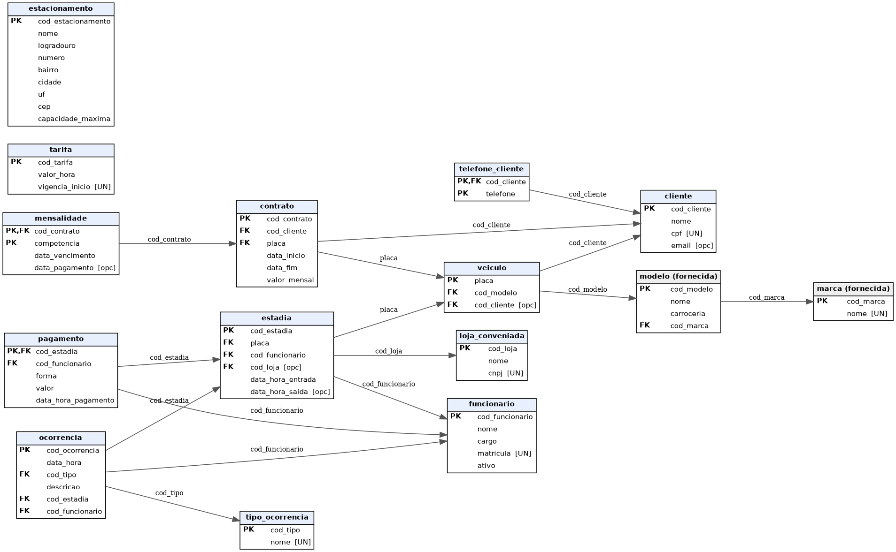

# Modelo lógico

Diagrama: [`diagrama_logico.png`](diagrama_logico.png) (vetorial: [`diagrama_logico.svg`](diagrama_logico.svg)); fonte: [`diagrama_logico.dot`](diagrama_logico.dot).



Legenda: **PK** chave primária · **FK** chave estrangeira · **[UN]** UNIQUE · **[opc]** aceita NULL. A seta vai da FK para a PK referenciada. Cinza = tabelas fornecidas.

## Esquema relacional (texto)

```
marca(cod_marca PK, nome UN)                                   -- fornecida
modelo(cod_modelo PK, nome, carroceria, cod_marca FK→marca)    -- fornecida
estacionamento(cod_estacionamento PK, nome, logradouro, numero, bairro, cidade, uf, cep, capacidade_maxima)
funcionario(cod_funcionario PK, nome, cargo, matricula UN, ativo)
cliente(cod_cliente PK, nome, cpf UN, email [opc])
telefone_cliente(cod_cliente PK/FK→cliente, telefone PK)
veiculo(placa PK, cod_modelo FK→modelo, cod_cliente FK→cliente [opc])
tarifa(cod_tarifa PK, valor_hora, vigencia_inicio UN)
loja_conveniada(cod_loja PK, nome, cnpj UN)
estadia(cod_estadia PK, placa FK→veiculo, cod_funcionario FK→funcionario,
        cod_loja FK→loja_conveniada [opc], data_hora_entrada, data_hora_saida [opc])
pagamento(cod_estadia PK/FK→estadia, cod_funcionario FK→funcionario, forma, valor, data_hora_pagamento)
contrato(cod_contrato PK, cod_cliente FK→cliente, placa FK→veiculo, data_inicio, data_fim, valor_mensal)
mensalidade(cod_contrato PK/FK→contrato, competencia PK, data_vencimento, data_pagamento [opc])
tipo_ocorrencia(cod_tipo PK, nome UN)
ocorrencia(cod_ocorrencia PK, data_hora, cod_tipo FK→tipo_ocorrencia, descricao,
           cod_estadia FK→estadia, cod_funcionario FK→funcionario)
```

## Tradução conceitual → lógico

| No conceitual | No lógico | Justificativa |
|---|---|---|
| Cliente possui Veículo (0,N)–(0,1) | `veiculo.cod_cliente` (FK, aceita NULL) | 1:N com participação opcional do lado veículo (RN02). |
| Veículo é do Modelo (1,1)–(0,N) | `veiculo.cod_modelo` (FK, NOT NULL) | Participação obrigatória (RN01). |
| Cliente é titular de Contrato (0,N)–(1,1) | `contrato.cod_cliente` (FK, NOT NULL) | 1:N. |
| Contrato cobre Veículo (1,1)–(0,N) | `contrato.placa` (FK, NOT NULL) | Um contrato, um veículo (RN12). |
| Entidade fraca Mensalidade | `mensalidade` com PK composta (`cod_contrato`, `competencia`) | A entidade fraca herda a PK da dona + identificador parcial. |
| Entidade fraca Pagamento (1:1 com Estadia) | `pagamento` com PK = FK `cod_estadia` | PK = FK impõe "um pagamento por estadia" (RN10). |
| Veículo entra Estadia; Funcionário registra Estadia | `estadia.placa` e `estadia.cod_funcionario` (FKs NOT NULL) | 1:N. |
| Estadia vinculada a Loja (0,1)–(0,N) | `estadia.cod_loja` (FK, aceita NULL) | Opcional (RN11). |
| Ocorrência: envolve, registra, classificada | `ocorrencia.cod_estadia`, `.cod_funcionario`, `.cod_tipo` (FKs NOT NULL) | Participação (1,1) em todas. |
| Atributo composto Endereço (Estacionamento) | colunas `logradouro`, `numero`, `bairro`, `cidade`, `uf`, `cep` | Só valores simples no lógico. |
| Atributo multivalorado Telefone (Cliente) | tabela `telefone_cliente(cod_cliente, telefone)` | Multivalorado vira outra tabela. |
| Tarifa × Estadia | **sem FK**: a tarifa é encontrada por data (`MAX(vigencia_inicio) <= data da entrada`) | A tarifa "vigente na data da entrada" é derivada (RN08/RN09); FK causaria redundância e erro ao corrigir tarifas. |
| Tipo derivado (rotativa/mensalista) | **sem coluna** | Derivado de contrato × data (RN07). |
| N:N | nenhum N:N no modelo | Todos os relacionamentos são 1:1 ou 1:N. |

Diferenças em relação ao conceitual: no lógico, `tipo_ocorrencia` e `telefone_cliente` aparecem como tabelas por tradução de domínio e de multivalorado; os relacionamentos desaparecem (viram FKs ou PKs compostas); `estacionamento` permanece sem FKs (unidade única).

## Normalização (até a 3FN)

- **1FN**: todos os atributos são atômicos. Endereço foi decomposto em colunas; telefones foram para tabela própria.
- **2FN**: tabelas com PK composta (`telefone_cliente`, `mensalidade`) não têm atributos que dependam de parte da chave (em `mensalidade`, vencimento e pagamento dependem de contrato **e** competência).
- **3FN**: não há dependência entre atributos não-chave. Itens que seriam transitivos foram evitados: marca/modelo vêm de `veiculo → modelo → marca` (não são copiados); o valor devido, o tipo da estadia e as vagas livres são **derivados**, não armazenados; o valor da mensalidade vem do contrato; o nome do cliente não é repetido em `veiculo` nem em `contrato`.
